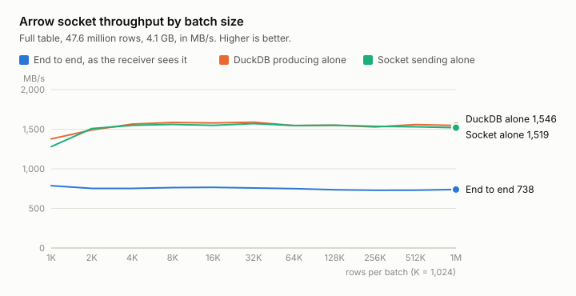

# NQ Lake 0.5.0

A query result of any size can now leave the backend as one Arrow IPC
stream over a Unix domain socket. The console is unchanged.

## Backend API

`POST /query/arrow` takes `{"sql", "batch_size", "socket_path"}` and moves
the whole result out of band. The HTTP call is only the trigger: the backend
binds a Unix domain socket, answers 202 with its path, and a thread waits
for one receiver to connect. The receiver reads one Arrow IPC stream from
the socket, the schema, one record batch of `batch_size` rows at a time,
and the end-of-stream marker, with `pyarrow.ipc.open_stream` or any other
Arrow implementation. DuckDB produces each batch when the writer asks for
it, so neither side holds the result whole. The README has a receiver in
ten lines.

- The socket is `ARROW_SOCKET_PATH` from `.env`, by default
  `images/api/state/arrow.sock`, unless the request body names another
  absolute path. One transfer runs per path at a time; a second trigger on
  a busy path answers 409. The socket file is removed when the transfer
  ends, however it ends.
- `batch_size` defaults to 65,536 rows and goes up to 1,000,000. DuckDB's
  own default of one million rows would make one batch of a wide table
  hundreds of megabytes.
- A rejected statement answers 422 before the socket is bound, with the
  same JSON error as `/query`. A receiver that does not connect within 60
  seconds abandons the transfer.
- A DuckDB error after the stream began ends it with a truncated message.
  Arrow readers take a clean end of file for the end of the stream, with or
  without the end-of-stream marker, so a plain close would hand the receiver
  the rows so far as a complete result. The header of a message whose body
  never arrives is what every reader rejects; PyArrow raises `ArrowInvalid`.
- Transfers log to the API log: rows sent, or why the transfer stopped.

The code is `nqlake.lake.stream`. `nqlake.lake.query` gained `bind()` and
`arrow_reader()`, which `/query` shares.

### Throughput

Measured on the local stack with the 47.6 million row, 14 column
`glbx_mdp3_20260803_mbo` table, 4.1 GB as Arrow, on one machine, with a
PyArrow receiver that reads every batch and keeps nothing. Every row of the
result was checked against DuckDB's own totals for the same query.

| Rows per batch | Batches | Message | End to end | First batch after |
|---|---|---|---|---|
| 1,024 | 46,447 | 0.09 MB | 787 MB/s | 0.04 s |
| 8,192 | 5,806 | 0.7 MB | 763 MB/s | 0.03 s |
| 65,536 | 726 | 5.6 MB | 750 MB/s | 0.03 s |
| 262,144 | 182 | 23 MB | 729 MB/s | 0.06 s |
| 1,000,000 | 48 | 85 MB | 738 MB/s | 0.15 s |

The batch size does not move the throughput. It sets the first-batch
latency and the size of the message both sides hold at once, so the
default of 65,536 stays. Only 1,024-row batches cost anything: DuckDB's
vectors hold 2,048 rows, and smaller batches split them.

The ceiling is structural. DuckDB produces batches at about 1,550 MB/s and
the socket sends them at about 1,550 MB/s, but the sending thread does the
two one after the other, so a transfer takes the sum of both times.

| Rows per batch | DuckDB produces | Socket sends | Total |
|---|---|---|---|
| 1,024 | 3.00 s | 3.23 s | 6.2 s |
| 2,048 | 2.76 s | 2.73 s | 5.5 s |
| 65,536 | 2.65 s | 2.65 s | 5.3 s |
| 1,000,000 | 2.65 s | 2.70 s | 5.3 s |

Overlapping the two, a producer thread feeding a queue that a sender
thread drains, would bring the transfer close to the slower of the two,
about 3 seconds for this table. It is left out on purpose: the transfer is
one loop with no queue, and a bounded queue is exactly the back-pressure
question this release does not answer.

## Upgrading a checkout

1. `make up`. No new dependency; `uv.lock` carries the version bump only.
2. Optionally set `ARROW_SOCKET_PATH` in `.env`. Without it the socket
   lives under `images/api/state/`, which is gitignored.

## Known limits

- The sending thread has no send timeout. A receiver that connects and
  stops reading holds the thread, the DuckDB cursor, and the path until it
  disconnects.
- There is no endpoint reporting a transfer's outcome; it is in the API
  log only.
- One transfer per socket path at a time. Parallel transfers need
  different `socket_path` values.
- The socket is a file on the host, so the receiver must run on the same
  machine as the backend. Like the API, it is not authenticated.
